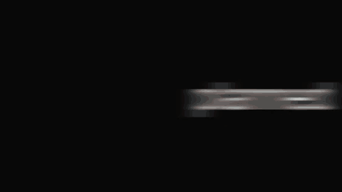
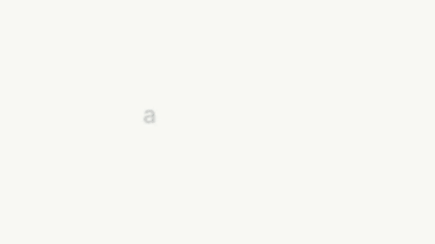
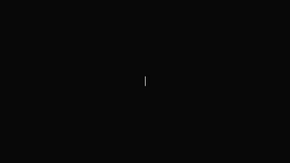
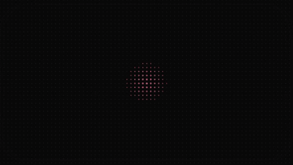

# Agent video

Launch films for agent products, as data. A Remotion 4 kit of primitives and
scenes, five template films (Launch film, Ask Acme, What's new, App launch, Why
switch), and a knowledge base of 155 teardowns: every snapcn template, free
component and Pro component, with timings in frames and rebuild steps.

Swap the copy, render, post.

## Previews

Rendered from this kit at 480x270, 12 fps. This is what an agent produces from
the knowledge base plus the kit; contact sheets with one frame per beat are next
to each GIF in `media/`.

| Template                                                                  | Built from (teardown)                               | Preview                                 |
| ------------------------------------------------------------------------- | --------------------------------------------------- | --------------------------------------- |
| `launch-film`: claim, parallel agents, one tap, offer, proof, mark        | [template-06](./knowledge/templates/template-06.md) |  |
| `ask-agent`: chat-first, plan and render, change from the phone, app icon | [template-07](./knowledge/templates/template-07.md) |       |
| `whats-new`: release film, fixes, checklist, publish                      | [template-08](./knowledge/templates/template-08.md) |     |
| `app-launch`: app icon, someday list, phone, lockup                       | [template-09](./knowledge/templates/template-09.md) |    |
| `why-switch`: against keyframes, repo, privacy, link                      | [template-10](./knowledge/templates/template-10.md) |    |

Regenerate with `bun run --cwd collections/agent-video previews -- --gif`
(sheets always, GIFs with `--gif`, 960x540 MP4s with `--video`).

## Commands

The kit has its own install so the repo root stays light. Each collection is its
own package, so scripts run through `--cwd`.

```bash
bun install --cwd collections/agent-video             # once: Remotion, React, renderer
bun run --cwd collections/agent-video demo            # Remotion Studio: scrub every template
bun run --cwd collections/agent-video render -- launch-film out/launch-film.mp4
bun run --cwd collections/agent-video previews        # contact sheets in media/ (add -- --video for mp4s)
bun run --cwd collections/agent-video typecheck
bun run --cwd collections/agent-video test            # pure tests; run by the root bun test too
```

Rendering downloads Remotion's Chrome Headless Shell once, and Inter and
JetBrains Mono load from Google Fonts at render time. Nothing third-party is
committed.

## Make a film

1. Copy a template from `src/templates/` (for example `launch-film.ts`).
2. Change `id`, `title`, `accent` (`coral`, `teal`, `amber`, `rose`, `leaf`,
   `blue`, `indigo`, `ochre`, `slate` or a hex), `brand` and every string in
   `props`. `copySlots(spec)` in `src/core/spec.ts` lists all of them.
3. Keep beat lengths near the reference; scenes stretch to any length, but a
   beat under about 40 frames rarely reads.
4. Add it to `src/templates/index.ts`, run the tests (they validate ids, frames,
   scene kinds, copy length and film length), then render.

## Layout

```
src/core/       pure TS: tokens (palettes, springs, timing), motion maths, template spec + validate
src/kit/        primitives: Blur, Camera, Reveal, Typewriter, SplitText, WordDrum, OutlineType,
                Pill, Card, ChatBubble, Composer, Cursor, Phone, Window, AppScreen,
                Grid, Halftone, RadialBloom, Particles, Bars, Icon, Mark
src/scenes/     one file per scene kind; kinds.ts lists them, index.tsx registers them
src/templates/  one TemplateSpec per film (pure data)
src/render/     TemplateFilm: beats back to back, hard cuts, optional whip exits
knowledge/      155 teardowns + system.md + generated README and index.json
scripts/        previews.ts (contact sheets, mp4), knowledge-index.ts
media/          renders of our own templates
```

## Rules the kit encodes

- Paper `#F8F8F4` and ink `#080808` acts; one low-saturation accent per film.
- Beats are back to back with cuts on exact frames; acts flip on the cut.
- Every scene is a pure function of the frame (seek-safe), designed at a
  reference length and stretched with `f(n)`.
- Fast moves blur along their axis (SVG Gaussian with separate x and y) and land
  sharp; text holds 30 frames or more.
- Text renders with `geometricPrecision`; no glow blobs or mesh gradients.

Details and measurements: [knowledge/system.md](./knowledge/system.md).

## Provenance

The knowledge base studies snapcn (Shadcn Labs). Free components were read from
their MIT source; templates and Pro components only from their public demo
films. No snapcn code, film or asset is in this collection. The kit and its
templates are written from scratch with our own copy and brand placeholders.
Research notes:
[catalogue/research/snapcn-agent-video.md](../../catalogue/research/snapcn-agent-video.md).
