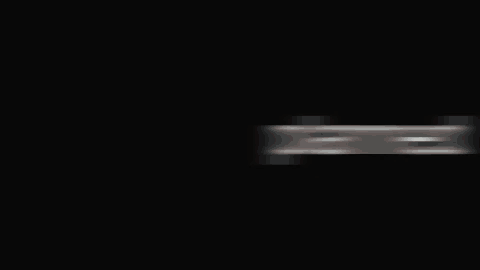

# Agent video knowledge

Teardowns of a commercial Remotion video library (snapcn, by Shadcn Labs): 10
paid template films, 63 free MIT components and 82 paid Pro components. Each doc
says what the piece shows, its timeline in frames at 30 fps, the techniques in
this kit's vocabulary, the props a rebuild takes, numbered rebuild steps and
pitfalls. Generated file: run `bun scripts/knowledge-index.ts` after editing a
doc.

## How to read the evidence

- `(source)`: read in the MIT source code of a free component.
- `(observed)`: seen in frames of the public demo film, or measured from it.
- `(inferred)`: a reading of motion between sampled frames. Check it before you
  copy a number.

Paid items were studied from their public demo films only; their source is not
public and was not used. The rebuild vocabulary (`Camera`, `MotionBlur`,
`Typewriter`, ...) maps to `src/kit/` and `src/scenes/` in this collection. The
shared system (acts, cuts, accents, motion tokens) is in
[system.md](./system.md).

## What the kit renders

Our own rebuilds of templates 06 to 10, rendered by `src/` (see the
[collection README](../README.md#previews) for all five):

## Templates

| Template                                                                                           | Length                          | Palette                                     | Doc                                       |
| -------------------------------------------------------------------------------------------------- | ------------------------------- | ------------------------------------------- | ----------------------------------------- |
| **Product launch**: A bright launch film that moves from a pile of work to agents that ship, for a | 660 frames (22 s), 10 beats     | light #F8F8F4, dark #080808, accent #5591F0 | [template-01](./templates/template-01.md) |
| **Weekly changelog**: A dark changelog film that types the request, builds the release, and closes | 744 frames (24.8 s), 11 beats   | light #F4F4F4, dark #080808, accent none    | [template-02](./templates/template-02.md) |
| **Feature drop**: One requested feature becomes a rendered video: ask, build, preview, launch.     | 592 frames (19.73 s), 9 beats   | light #F0F0F0, dark #080808, accent #36407F | [template-03](./templates/template-03.md) |
| **Startup pitch**: A demo-day pitch on warm paper: problem, product, numbers, ask, lockup.         | 583 frames (19.43 s), 10 beats  | light #F8F8F4, dark #000000, accent #B7875A | [template-04](./templates/template-04.md) |
| **Product tour**: A bright end-to-end walkthrough: ask the product to build a tour, watch it       | 933 frames (31.1 s), 11 beats   | light #F8F8F4, dark #000000, accent none    | [template-05](./templates/template-05.md) |
| **Launch film**: Three words stake the claim, every scene renders at once, one tap ships it,       | 797 frames (26.57 s), 7 beats   | light #F8F8F4, dark #080808, accent #D9654F | [template-06](./templates/template-06.md) |
| **Ask snapcn**: A chat-first product story: ask for a film in a message, watch it plan and         | 1124 frames (37.47 s), 13 beats | light #F8F8F4, dark #080808, accent #3E968E | [template-07](./templates/template-07.md) |
| **What's new**: A release-notes film: tease the update, name what shipped, prove the fixes,        | 1128 frames (37.6 s), 11 beats  | light #F8F8F4, dark #080808, accent #CC9544 | [template-08](./templates/template-08.md) |
| **App launch**: Show a phone app that turns a backlog of video ideas into finished, shareable      | 955 frames (31.83 s), 11 beats  | light #F8F8F4, dark #080808, accent #A24F6A | [template-09](./templates/template-09.md) |
| **Why switch**: Argue against keyframe tools and for a component library that renders              | 976 frames (32.53 s), 11 beats  | light #F8F8F4, dark #080808, accent #68A34C | [template-10](./templates/template-10.md) |

## Free components (MIT source)

### ai-input

| Component                                      | What it is                                                                    | Length | Used in templates |
| ---------------------------------------------- | ----------------------------------------------------------------------------- | ------ | ----------------- |
| [Agent Steps](./free/agent-steps.md)           | A prompt pill with a self-writing task log that collapses into a result pill. | 160 f  |                   |
| [Answer Highlight](./free/answer-highlight.md) | A question pill, an answer that writes itself, and a selection drag that      | 190 f  |                   |
| [Answer Stream](./free/answer-stream.md)       | A macro shot on the send button cuts hard to the answer streaming in word by  | 150 f  |                   |
| [Prompt Send](./free/prompt-send.md)           | A glass composer that unrolls from a hairline, types a brief while the camera | 165 f  |                   |
| [Prompt Zoom](./free/prompt-zoom.md)           | An assistant home screen that hard-cuts into its own input mid-sentence while | 90 f   |                   |
| [Search Typing](./free/search-typing.md)       | A search field wider than the shot types a query, pages across, then lands    | 210 f  |                   |

### captions

| Component                                      | What it is                                                                     | Length | Used in templates |
| ---------------------------------------------- | ------------------------------------------------------------------------------ | ------ | ----------------- |
| [Karaoke Captions](./free/karaoke-captions.md) | A caption line that fills word by word as it is spoken, in heavy outlined type | 150 f  |                   |
| [Word Captions](./free/word-captions.md)       | Burned-in word captions in channel styles with the spoken word popping. Use it | 96 f   |                   |

### cursor

| Component                              | What it is                                                                    | Length | Used in templates |
| -------------------------------------- | ----------------------------------------------------------------------------- | ------ | ----------------- |
| [Button Press](./free/button-press.md) | A scripted cursor walks onto a split action button, presses it, and the label | 126 f  |                   |
| [Click Type](./free/click-type.md)     | A cursor flies in, clicks a prompt field, and the request types itself in     | 103 f  |                   |

### effects

| Component                                  | What it is                                                               | Length | Used in templates |
| ------------------------------------------ | ------------------------------------------------------------------------ | ------ | ----------------- |
| [Pulsing Border](./free/pulsing-border.md) | A transparent glowing frame that breathes around the scene edges while a | 180 f  |                   |

### logos

| Component                                  | What it is                                                                   | Length | Used in templates |
| ------------------------------------------ | ---------------------------------------------------------------------------- | ------ | ----------------- |
| [Block Wordmark](./free/block-wordmark.md) | A square scales in, shuffles a coloured deck, splits into letter blocks, and | 150 f  |                   |
| [Logo Assemble](./free/logo-assemble.md)   | A ring of image cards revolves around a title, then drains into a logo and   | 108 f  |                   |
| [Logo Collapse](./free/logo-collapse.md)   | A stack of photo cards flicks through shrinking sizes and collapses into a   | 52 f   |                   |
| [Logo Drift](./free/logo-drift.md)         | A headline lands word by word over a drifting wall of integration tiles      | 108 f  |                   |
| [Logo Flicker](./free/logo-flicker.md)     | Full-screen images strobe at a constant rate, then cross-fade onto a logo    | 100 f  |                   |

### scenes

| Component                                      | What it is                                                                     | Length | Used in templates |
| ---------------------------------------------- | ------------------------------------------------------------------------------ | ------ | ----------------- |
| [Announce Title](./free/announce-title.md)     | A four-shot launch title: rush, colour field, paper name, glowing tagline. Use | 170 f  |                   |
| [Bloom Lockup](./free/bloom-lockup.md)         | A card wall blooms outward from the logo, cuts tight, bends away through a     | 120 f  |                   |
| [Card Rail](./free/card-rail.md)               | A rail of cards flicked sideways across a tilted 3D plane. Use it to browse a  | 108 f  |                   |
| [Count Grid](./free/count-grid.md)             | Five cards rush in under a smear, then the grid fills from the middle out as   | 47 f   |                   |
| [Cut Lockup](./free/cut-lockup.md)             | A logo landing huge on grid paper, stepping down in hard cuts, drawing itself  | 108 f  |                   |
| [Gather Lockup](./free/gather-lockup.md)       | A wall of work under a headline falls apart, cuts to a row of four, and each   | 56 f   |                   |
| [Product Hero](./free/hero-launch.md)          | Two media cards slide into a symmetric formation as the headline reveals above | 170 f  |                   |
| [Moodboard Reveal](./free/moodboard-reveal.md) | A kinetic headline with a swapping inline image opens into an orbiting photo   | 150 f  |                   |
| [Orb Swarm](./free/orb-swarm.md)               | Six text cards told one beat at a time while glass orbs split, swarm and       | 160 f  |                   |
| [Orbit Gallery](./free/orbit-gallery.md)       | A stream of photos flows along an inward spiral around a held title. Use it as | 300 f  |                   |
| [Portal Intro](./free/portal-intro.md)         | A sentence that grows a picture chip mid-line, leans in until the chip takes   | 108 f  |                   |
| [Reel Collage](./free/reel-collage.md)         | A photo reel that shuts like an eyelid between two captions, then blooms into  | 96 f   |                   |
| [Reel Wall](./free/reel-wall.md)               | A ring of vertical clips turns past in the dark for launch and recap films.    | 270 f  |                   |
| [Roster Grant](./free/roster-grant.md)         | Three roster rows stream past a call to action, a cursor clicks it, and the    | 120 f  |                   |
| [Sky Lockup](./free/sky-lockup.md)             | A promise takes itself apart word by word, then the mark lands as the          | 57 f   |                   |
| [Status Cycle](./free/status-cycle.md)         | A status pill cycles its label, then the field crossfades into a stepping chip | 198 f  |                   |
| [Wordmark Cut](./free/wordmark-cut.md)         | A giant wordmark cools from a lit gradient to ink, then cuts closer onto its   | 66 f   |                   |

### screens

| Component                                          | What it is                                                                     | Length | Used in templates |
| -------------------------------------------------- | ------------------------------------------------------------------------------ | ------ | ----------------- |
| [Capture Reveal](./free/capture-reveal.md)         | A screenshot being taken: a counter runs to 100% in a toast, the window drops  | 130 f  |                   |
| [Cursor Track](./free/cursor-track.md)             | A synthetic cursor that walks normalized waypoints and pulses a click ring on  | 132 f  |                   |
| [Laptop Frame](./free/laptop-frame.md)             | A MacBook-style laptop that opens, shows a notch notification, then dives into | 240 f  |                   |
| [Phone Frame](./free/phone-frame.md)               | An iPhone-style device frame that enters flat or tilted and can fly a          | 240 f  |                   |
| [Phone Stack](./free/phone-stack.md)               | Five phone screens that rise out of a glow one after another, each new arrival | 120 f  |                   |
| [Screen Recording](./free/screen-recording.md)     | A treated product capture with cropped chrome and a keyframed push-in camera.  | 139 f  |                   |
| [Terminal Simulator](./free/terminal-simulator.md) | A camera flies over one dark world: headline, install command, then a typing   | 200 f  |                   |

### social

| Component                                  | What it is                                                                   | Length | Used in templates |
| ------------------------------------------ | ---------------------------------------------------------------------------- | ------ | ----------------- |
| [Channel Thread](./free/channel-thread.md) | A work chat filling itself in one message at a time, with typing dots and    | 110 f  |                   |
| [Follower Rush](./free/follower-rush.md)   | An X-style follower notification that piles avatars into a row, explodes the | 300 f  |                   |

### text

| Component                                  | What it is                                                                     | Length | Used in templates |
| ------------------------------------------ | ------------------------------------------------------------------------------ | ------ | ----------------- |
| [Brand Wheel](./free/brand-wheel.md)       | A lead word plus a rolling wheel of brand pills that stops on the last brand   | 139 f  |                   |
| [Check Cycle](./free/check-cycle.md)       | A sentence that finishes itself several ways beside a ticked checkbox, then    | 136 f  |                   |
| [Drop Line](./free/drop-line.md)           | One word per card on an ink field; the last word sinks away from under its own | 38 f   |                   |
| [Font Shuffle](./free/font-shuffle.md)     | A launch line that decodes out of scrambled glyphs, flashes the accent, then   | 115 f  |                   |
| [Hello Zoom](./free/hello-zoom.md)         | Words flicker and grow on a dark card, one lands huge on a light card, its     | 75 f   |                   |
| [Punch Lines](./free/punch-lines.md)       | Full-frame title cards that cut hard between a flicked-in statement and        | 144 f  |                   |
| [Spec Sweep](./free/spec-sweep.md)         | One centred line slides in word by word while a highlight reads along it.      | 75 f   |                   |
| [Text Build](./free/text-build.md)         | One line grows word by word while the placed words slide aside to stay         | 75 f   |                   |
| [Text Highlight](./free/text-highlight.md) | One span inside a static sentence gets emphasized, then the default look ends  | 56 f   |                   |
| [Text Reveal](./free/text-reveal.md)       | A lead word lands huge, drifts closer, falls back, and pulls the rest of the   | 90 f   |                   |
| [Text Rewrite](./free/text-rewrite.md)     | A line writes itself, jumps toward the viewer, gets selected, loses its        | 102 f  |                   |
| [Text Select](./free/text-select.md)       | A line types itself word by word, pushes toward the viewer, and takes a        | 72 f   |                   |
| [Text Swap](./free/text-swap.md)           | One line exits and another enters on an exit-then-enter schedule, hardest in   | 90 f   |                   |
| [Text Swell](./free/text-swell.md)         | A lead word floats toward the viewer and hangs there while the sentence builds | 110 f  |                   |
| [Title Sweep](./free/title-sweep.md)       | A centered title on black is lit by a warm gradient that travels across its    | 76 f   |                   |
| [Type Morph](./free/type-morph.md)         | A headline types itself, sheds its lead, morphs into a new phrase letter by    | 94 f   |                   |
| [Word Flip](./free/word-flip.md)           | A sentence types itself, then one word cycles on a 3D flip while the rest      | 180 f  |                   |
| [Word Gather](./free/word-gather.md)       | A sentence gathers one word at a time out of order and settles into a line.    | 49 f   |                   |
| [Word Wheel](./free/word-wheel.md)         | A word column spins like a slot reel behind a fixed lead-in and stops on one   | 66 f   |                   |

### transitions

| Component                        | What it is                                                                    | Length | Used in templates |
| -------------------------------- | ----------------------------------------------------------------------------- | ------ | ----------------- |
| [Dot Bloom](./free/dot-bloom.md) | A halftone dot transition that washes the outgoing shot to cream, then clears | 30 f   |                   |

### ui-primitives

| Component                                     | What it is                                                                    | Length | Used in templates |
| --------------------------------------------- | ----------------------------------------------------------------------------- | ------ | ----------------- |
| [snap-cn-ui primitives](./free/snap-cn-ui.md) | The shared theme, timeline math, caret, and input atoms that scene components | 120 f  |                   |

## Pro components (paid; from demo films)

### ai-input

| Component                               | What it is                                                                    | Length | Used in templates |
| --------------------------------------- | ----------------------------------------------------------------------------- | ------ | ----------------- |
| [Agent Chat](./pro/agent-chat.md)       | A prompt typed, sent, and answered in a minimal chat thread.                  | 200 f  |                   |
| [Agent Compose](./pro/agent-compose.md) | A composer that builds itself around a chip, then takes a request.            | 112 f  |                   |
| [Agent Open](./pro/agent-open.md)       | A positioning line that assembles, resolves to a brand name, then becomes a   | 144 f  |                   |
| [Agent Result](./pro/agent-result.md)   | A dark composer that sends a request and hands back a built answer card.      | 150 f  |                   |
| [Agent Run](./pro/agent-run.md)         | A typed request, a pressed send, and an agent run that narrates each step.    | 320 f  |                   |
| [Agent Tools](./pro/agent-tools.md)     | A spark-written hook, a tool-granting composer, and a handoff to the answer.  | 322 f  |                   |
| [Files Drop](./pro/files-drop.md)       | A handful of frames flies into a prompt and becomes attachments. Use it for   | 90 f   |                   |
| [Glass Prompt](./pro/glass-prompt.md)   | A prompt types into a pane of glass, then the camera dives through its send   | 151 f  |                   |
| [Prompt Dive](./pro/prompt-dive.md)     | A phone assistant that takes a typed request before the camera dives into its | 201 f  |                   |
| [Prompt Roll](./pro/prompt-roll.md)     | A typed prompt whose option words roll through tinted pills, ending in a      | 193 f  |                   |
| [Search Retype](./pro/search-retype.md) | A search field that types one query, deletes it, and types a better one, for  | 125 f  |                   |
| [Task Stream](./pro/task-stream.md)     | An agent task list that streams in and ticks off one row at a time.           | 238 f  |                   |

### charts

| Component                               | What it is                                                                     | Length | Used in templates |
| --------------------------------------- | ------------------------------------------------------------------------------ | ------ | ----------------- |
| [Hex Tally](./pro/hex-tally.md)         | A metric card that counts to its total while a hex unit chart fills in beneath | 54 f   |                   |
| [Metric Morph](./pro/metric-morph.md)   | An export button that collapses into the tallest cell of the chart it          | 52 f   |                   |
| [Scatter Bloom](./pro/scatter-bloom.md) | A scatter plot that blooms point by point on a drifting tilted plane, for      | 98 f   |                   |
| [Tally Rise](./pro/tally-rise.md)       | A payout figure that counts up while its blue light drains to black.           | 46 f   |                   |
| [Ticker Climb](./pro/ticker-climb.md)   | A claim over a climbing line, then a live ticker proving it with a count and a | 77 f   |                   |
| [Vault Count](./pro/vault-count.md)     | A vault balance ticking up while payment cards drift past it.                  | 92 f   |                   |

### logos

| Component                               | What it is                                                                  | Length | Used in templates |
| --------------------------------------- | --------------------------------------------------------------------------- | ------ | ----------------- |
| [Lockup Reveal](./pro/lockup-reveal.md) | A logo lockup that assembles on a construction grid, then turns out to be a | 150 f  |                   |

### scenes

| Component                                       | What it is                                                                     | Length | Used in templates |
| ----------------------------------------------- | ------------------------------------------------------------------------------ | ------ | ----------------- |
| [Blueprint Collage](./pro/blueprint-collage.md) | A headline that cycles three phrases while pictures hop around it in stop      | 56 f   |                   |
| [Column Cut](./pro/column-cut.md)               | A highlighted slogan that cuts to a jumping image column framed by a closing   | 53 f   |                   |
| [Depth Swap](./pro/depth-swap.md)               | A headline that swaps inside a wall of pictures with real depth of field.      | 74 f   |                   |
| [Flood Outro](./pro/flood-outro.md)             | An end card where the lockup writes in over a wave, then a gradient floods the | 75 f   |                   |
| [Glow Frame](./pro/glow-frame.md)               | A violet glowing border breathes around the frame while a small line brightens | 37 f   |                   |
| [Glow Map](./pro/glow-map.md)                   | A dotted world map that fades in while glowing location markers pop across it. | 150 f  |                   |
| [Glow Type](./pro/glow-type.md)                 | A small glowing line builds word by word, then the camera dives through giant  | 150 f  |                   |
| [Guide Reel](./pro/guide-reel.md)               | A fast montage card that flashes through sample scenes, then lands on a        | 107 f  |                   |
| [Hype Reel](./pro/hype-reel.md)                 | A vertical video post going viral: its view count races up while reactions     | 97 f   |                   |
| [Lens Wall](./pro/lens-wall.md)                 | A wall of eighteen pictures that fades in, bends through a lens, and flashes   | 66 f   |                   |
| [Library Flight](./pro/library-flight.md)       | A title, a fly-through of the component library, and the line it adds up to.   | 130 f  |                   |
| [Mark Grid](./pro/mark-grid.md)                 | A typed line that lifts away into a tile wall gathered around the mark.        | 245 f  |                   |
| [Metal Chip](./pro/metal-chip.md)               | A brushed-metal tile carrying the mark settles from a tilt while a sheen       | 36 f   |                   |
| [Mood Board](./pro/mood-board.md)               | A collage that builds tile by tile under a headline, then runs into glowing    | 157 f  |                   |
| [Orbit Flow](./pro/orbit-flow.md)               | A centred line wrapped in three dashed orbits with labelled stops riding the   | 102 f  |                   |
| [Pain Point](./pro/pain-point.md)               | A jab at hand-animation types itself over a blue glow while editor panels      | 136 f  |                   |
| [Phone Burst](./pro/phone-burst.md)             | A phone that punches out of a spinning ray burst, holds, then sinks back. Use  | 29 f   |                   |
| [Prompt Poster](./pro/prompt-poster.md)         | A prompt types into a dark composer, a cursor presses send, and the film cuts  | 86 f   |                   |
| [Proof Line](./pro/proof-line.md)               | Five shipped cards that collapse one by one into the sentence they prove, for  | 47 f   |                   |
| [Render Wall](./pro/render-wall.md)             | Loose code that resolves into a wall of finished work and backs away, for      | 42 f   |                   |
| [Showcase Drift](./pro/showcase-drift.md)       | A wall of product cards that slides to rest behind a fixed headline.           | 90 f   |                   |
| [Version Drop](./pro/version-drop.md)           | A product name types itself across two jump cuts, then its version number      | 120 f  |                   |
| [Wire Feed](./pro/wire-feed.md)                 | A changelog headline types itself in close, then the film cuts wide as older   | 80 f   |                   |
| [Word Montage](./pro/word-montage.md)           | Seven pictures gather round a line that keeps changing its mind, then fall     | 130 f  |                   |

### screens

| Component                               | What it is                                                                     | Length | Used in templates |
| --------------------------------------- | ------------------------------------------------------------------------------ | ------ | ----------------- |
| [App Reveal](./pro/app-reveal.md)       | A wordmark that folds into an app card under a diving, rolling camera.         | 106 f  |                   |
| [Brief Send](./pro/brief-send.md)       | A project page exits and the typed brief that fills it gets sent. Use it for   | 130 f  |                   |
| [Build Out](./pro/build-out.md)         | A send button fills the frame, then the app it asked for draws itself. Use it  | 116 f  |                   |
| [Checkout Push](./pro/checkout-push.md) | A phone pays for something, then the camera dives at its screen. Use it for a  | 60 f   |                   |
| [Gallery Push](./pro/gallery-push.md)   | A wall of screenshots opens one column at a time. Use it to tour sites or      | 116 f  |                   |
| [Laptop Open](./pro/laptop-open.md)     | A laptop that pulls back from a blurred macro shot, holds whole, then swallows | 111 f  |                   |
| [LCD Type](./pro/lcd-type.md)           | A type specimen on a visible-pixel screen: a title exits upward, then lines    | 100 f  |                   |
| [Phone Pitch](./pro/phone-pitch.md)     | A headline beside a phone: the pitch shot, with the thread on screen answering | 235 f  |                   |
| [Picker Commit](./pro/picker-commit.md) | A settings wheel that flings to a stop and commits its row into a button, for  | 78 f   |                   |
| [Screen Wall](./pro/screen-wall.md)     | Four phones in a tunnel that back out to frame a building sentence, for kit    | 70 f   |                   |
| [String Hero](./pro/string-hero.md)     | A code editor push-in that ends on the install string as a giant headline.     | 89 f   |                   |
| [Tap Through](./pro/tap-through.md)     | A phone dive from a feed to its buttons, a tap, then the tagline the tap was   | 78 f   |                   |

### social

| Component                                   | What it is                                                                    | Length | Used in templates |
| ------------------------------------------- | ----------------------------------------------------------------------------- | ------ | ----------------- |
| [Chat Thread](./pro/chat-thread.md)         | A chat thread sends itself one bubble at a time. Use it for the moment a      | 110 f  |                   |
| [Comment Storm](./pro/comment-storm.md)     | A launch crowd buries the frame asking for Pro. Use it for social proof under | 273 f  |                   |
| [Thank You Swarm](./pro/thank-you-swarm.md) | A supporter marquee that tears away and returns as a wall of faces around a   | 127 f  |                   |

### text

| Component                                 | What it is                                                                     | Length | Used in templates                          |
| ----------------------------------------- | ------------------------------------------------------------------------------ | ------ | ------------------------------------------ |
| [Count Portal](./pro/count-portal.md)     | Words assemble one at a time, then slam through flipping light and dark acts   | 116 f  |                                            |
| [Cross Out](./pro/cross-out.md)           | Cross out the old advice, then name what replaces it. Use it for a correction  | 46 f   |                                            |
| [Echo Stack](./pro/echo-stack.md)         | One word with fading copies of itself stacked above and below in clipped       | 51 f   |                                            |
| [Ember Reveal](./pro/ember-reveal.md)     | A blue brush sweeps paper, blooms into a glow, and the line writes itself out  | 75 f   |                                            |
| [Find Yours](./pro/find-yours.md)         | A fixed headline beside a rolling list that rushes and brakes onto one answer. | 177 f  |                                            |
| [Focus Pull](./pro/focus-pull.md)         | Phrases resolve out of a moving colour field one at a time. Use it for a slow  | 98 f   |                                            |
| [Glow Pullback](./pro/glow-pullback.md)   | A bold line revealed word by word as the camera pulls back from a tight        | 60 f   |                                            |
| [Manifesto](./pro/manifesto.md)           | Three statements on black, each arriving differently, joined by hard cuts.     | 110 f  |                                            |
| [Pack Up](./pro/pack-up.md)               | A typed line that catches the light, breaks apart, and packs its last word     | 90 f   |                                            |
| [Phrase Swarm](./pro/phrase-swarm.md)     | A headline that bursts into loose letters and regathers as a new line, for     | 51 f   |                                            |
| [Read Through](./pro/read-through.md)     | An enormous sentence that reads itself a word at a time, for spoken-line       | 150 f  |                                            |
| [Say It](./pro/say-it.md)                 | A word that scrambles into a play control, gets pressed, and hands off to the  | 118 f  |                                            |
| [Sentence Set](./pro/sentence-set.md)     | A centred sentence that sets itself one word at a time for a quiet title beat. | 60 f   |                                            |
| [Slam Type](./pro/slam-type.md)           | Three gradient words slam in, each larger than the last, on black.             | 52 f   |                                            |
| [Spark Question](./pro/spark-question.md) | A hook that asks a question one huge phrase at a time while the camera pulls   | 170 f  | template-05 (Product tour), Hook — what if |
| [Spec Wall](./pro/spec-wall.md)           | Spec lines stack up on black, then the film cuts to paper and scrolls through  | 108 f  |                                            |
| [Stretch Word](./pro/stretch-word.md)     | A word that stretches by repeating a letter, exits left, then hands off to a   | 73 f   |                                            |
| [Trend Type](./pro/trend-type.md)         | A headline that types itself while the camera trails the caret and a wave runs | 88 f   |                                            |
| [Wall Cut](./pro/wall-cut.md)             | A sentence warms up on an LED wall, then a travelling band of light carries it | 90 f   |                                            |
| [Word Insert](./pro/word-insert.md)       | A line that grows from its last word as each new word slips in ahead of it.    | 90 f   |                                            |
| [Word Rush](./pro/word-rush.md)           | The camera flies through a field of hanging words, one line rushes the lens,   | 98 f   |                                            |
| [Word Settle](./pro/word-settle.md)       | A sentence appears word by word, each new word hot, cooling to ink as a color  | 60 f   |                                            |

### transitions

| Component                             | What it is                                                                     | Length | Used in templates |
| ------------------------------------- | ------------------------------------------------------------------------------ | ------ | ----------------- |
| [Dot Dissolve](./pro/dot-dissolve.md) | A halftone dot field that blooms to full coverage and dissolves back to black. | 38 f   |                   |
| [Pixel Peak](./pro/pixel-peak.md)     | A blocky stepped peak that climbs up and hands one shot to the next.           | 50 f   |                   |
