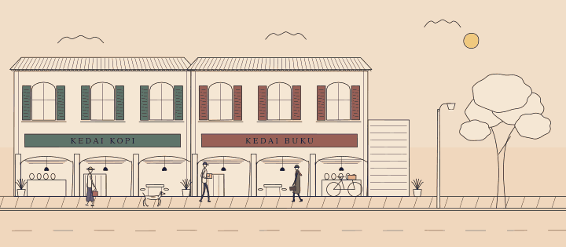
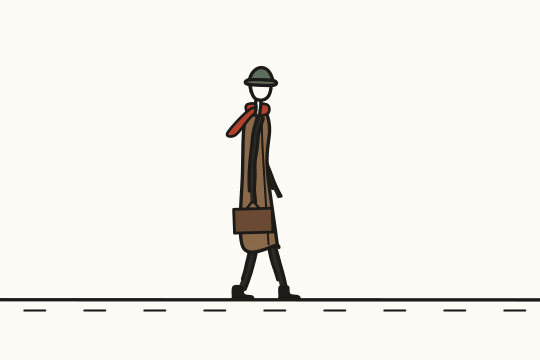
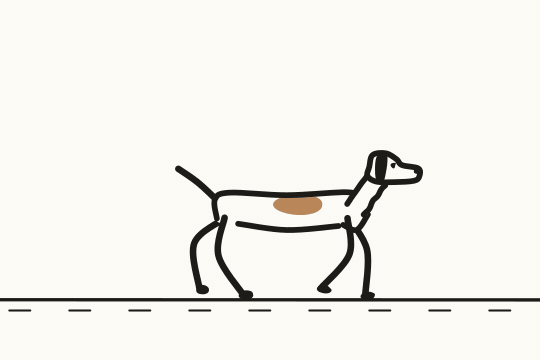
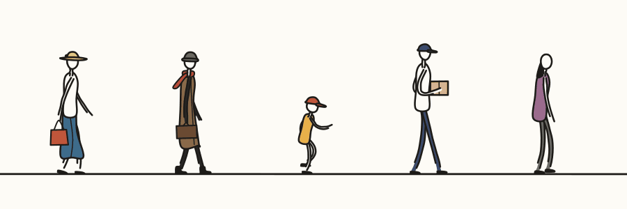

# Line Art

Animated ink-on-paper drawings in SVG, written in TypeScript with no
dependencies. People walk, run and wave. Dogs trot and cats prowl. Streets go
from day to night. All of it reacts to the pointer and exports to SVG, GIF or
video from the same code.



| Walk                                  | Trot                             |
| ------------------------------------- | -------------------------------- |
|  |  |



Still export (no filters, no CSS, opens anywhere):
[media/street-noon.svg](media/street-noon.svg).

## Commands

Each collection is its own package, so scripts run through `--cwd`.

```bash
bun run --cwd collections/line-art demo       # live demo at http://localhost:3000
bun run --cwd collections/line-art previews   # regenerate media/ (needs ffmpeg built with librsvg)
bun run --cwd collections/line-art typecheck  # strict tsc for src, test, demo, scripts
bun run --cwd collections/line-art test       # gait, boil, export and palette tests
```

Demo URL flags: `?tau=0.5` start time (0 midnight, 0.5 noon), `?day=60` seconds
per day (`0` pins the time), `?debug` manual stepping via `window.__step(s)`.

## How it fits together

```
Surface ── live DOM (domSurface) or headless tree (headlessSurface)
   │
stage() ── <svg> + paper stylesheet + root Ink
   │
Ink ────── pen weight, roughness, line boil; line / shape / paint / blot / fill / limb
   │
Figure ─── Body (rig: biped gait + arm springs + reach IK) → Skeleton
   │          └─ Parts draw around it: legs, arm, top, coat, skirt, head, scarf, bag, parcel
Animal ─── quadruped gait (walk, trot) → back line, belly line, legs, head, tail
   │
palette(τ) → applyPalette()        clock(draw) → live rAF or manual steps
toSVG() ── bake ink + paper → standalone SVG → ffmpeg → GIF / MP4
```

| Module         | Gives you                                                                                  |
| -------------- | ------------------------------------------------------------------------------------------ |
| `surface.ts`   | `domSurface()`, `headlessSurface()`, `VNode`                                               |
| `geometry.ts`  | `smoothPath`, `jointCurve`, `limbOutline`, `ik2`, `hang`, `rotate`, `ellipsePoints`        |
| `ink.ts`       | `Ink` (`line` `shape` `paint` `blot` `fill` `limb` `derive` `tick`), `stage`, `place`      |
| `gait.ts`      | `biped({ kind: 'walk' \| 'stroll' \| 'run' })`, `footAt` (shared foot path)                |
| `figure.ts`    | `Figure`, `Body`, `PLANS` (`adult` `tall` `child`), the `Part` contract                    |
| `parts.ts`     | `legs` `arm` `top` `coat` `skirt` `head` `scarf` `bag` `parcel`                            |
| `cast.ts`      | `CAST`: `commuter` `shopper` `kid` `courier` `elder`                                       |
| `quadruped.ts` | `quadruped({ kind: 'walk' \| 'trot' })`, `QUAD_PLANS` (`dog` `cat`)                        |
| `animal.ts`    | `Animal` (dog or cat) with `excite()`                                                      |
| `motion.ts`    | `spring` `pendulum` `wind` `bindPointerWind` `keys` `beats` `rng` `drift` `minJerk` `bump` |
| `palette.ts`   | `palette(τ)`, `applyPalette`, `nightTint`, `DAY_CYCLE`                                     |
| `export.ts`    | `toSVG(vnode, { ink, paper, width, background })`, `fromDOM(svgEl, window)`                |
| `clock.ts`     | `clock(draw, { manual, freezeAt, fps })`                                                   |

## A character in ten lines

```ts
import {
  stage,
  domSurface,
  clock,
  Figure,
  arm,
  legs,
  top,
  skirt,
  head,
  bag
} from './src/index.ts'

const st = stage(domSurface(), {
  width: 480,
  height: 240,
  mount: document.querySelector('#card')!
})
const s = 1.2
const anna = new Figure(st.ink.derive({ amp: 1 / s }), st.svg, {
  x: 40,
  y: 210,
  scale: s,
  gait: { kind: 'stroll' },
  parts: [
    arm('far'),
    legs(),
    skirt({ colour: '#3e6b8a' }),
    top(),
    head({ hair: 'bun', hat: 'sunhat', hatColour: '#e2c46a' }),
    arm('near'),
    bag({ colour: '#c0563b' })
  ]
})
clock((t, dt) => {
  st.ink.tick(t)
  anna.update(t, dt, { wind: 0.3 })
})
```

Parts stack in list order: far arm first, near arm and props last. A new garment
is one function that builds its nodes once and returns a draw callback that
reads the `Skeleton` (`hip`, `neck`, `head`, `shoulder`, `elbow`, `hand`,
`feet[i].knee/ankle/pitch`, `front`, `torso(u, side)`).

## The rules it encodes

- **Legs are solved, not animated.** A planted foot moves back at exactly
  `gait.speed`, so `Figure` moves the body by `speed × scale` and the foot stays
  put. Swings follow minimum-jerk paths; heels peel off the toe; hip height
  comes from leg reach (walks) or a ballistic arc (runs). The tests check zero
  foot slip for every biped and quadruped gait.
- **Limbs are two open strokes** around a soft curve through the joints, tapered
  and open at the far end.
- **Garments come from the skeleton.** Coats meet the forward knee and skirts
  part between the legs. Bags hang on pendulums and scarves trail on springs.
- **Lines boil.** Every stroke is re-inked at `boilFps` (default 10) with seeded
  noise. The same frame always draws the same line, so exports are reproducible.
- **Ink is `currentColor`, paper is `.pp`.** `applyPalette()` retints the whole
  drawing. `toSVG()` bakes both for files that must open without CSS.

## Origin

Engineered after a teardown of
[JDhruv14/line-art-animation](https://github.com/JDhruv14/line-art-animation)
(MIT). The research is in
[catalogue/research/line-art-animation.md](../../catalogue/research/line-art-animation.md).
The code here is written fresh: figure space, presets, palette stops, scenes and
characters are our own, and no files or assets were copied.
