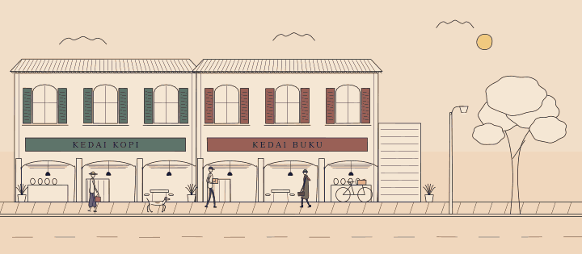

# TolongLabs Line Art

> TolongLabs' own library for animated ink-on-paper drawings in SVG: walking
> people, trotting dogs, living streets, day to night.
>
> Use it for any TolongLabs illustration that should move, react to the pointer,
> and export to SVG, GIF or video from the same code.

## At a glance

| Field          | Value                                                                             |
| -------------- | --------------------------------------------------------------------------------- |
| Source         | [`collections/line-art/`](../../../collections/line-art/README.md) in this repo   |
| Paywall        | **Free** — internal                                                               |
| Open source    | No — private TolongLabs code                                                      |
| Type           | Dependency-free TypeScript library (~2,100 lines) + skill                         |
| Works with     | Any page that can hold an `<svg>`; Bun or Node for headless rendering             |
| Best for       | Animated illustrations, character loops, scene GIFs, static SVG exports           |
| Agent-friendly | Yes — `line-art` skill, a cast of ready characters, deterministic headless output |

## What it is

Our own engineering of the ideas in
[line-art-animation](./line-art-animation.md), written fresh after a full
teardown ([research notes](../../research/line-art-animation.md)). It keeps the
mechanics that make the style work: open double-stroke limbs, solved gaits with
planted feet, springs and pendulums, and an ink/paper palette that inverts at
night. It adds four things the original does not have:

- **Rig + costume API.** A `Figure` is a body plan (`adult`, `tall`, `child`)
  plus a list of parts (`legs`, `arm`, `top`, `coat`, `skirt`, `head`, `scarf`,
  `bag`, `parcel`). Parts draw around the solved skeleton, so garments open with
  the stride. `body.reach()` drives hands with IK for gestures.
- **Line boil.** Strokes are re-inked at 8–12 fps with seeded noise, which gives
  the look of hand-drawn animation. It is geometry, not an SVG filter, so it
  survives export.
- **Quadruped gait.** Walk and trot solvers for dogs and cats on the same foot
  path as the biped, with hip and shoulder heights solved separately.
- **Surfaces and export.** The same scene code renders live into the DOM or
  headless in Bun. `toSVG()` bakes ink and paper colours, and
  `bun run line-art:previews` encodes GIFs through ffmpeg with no browser.



## Paywall and pricing

- **Free:** internal code; no cost.
- **Paid:** none.
- **Sign-up required?** Access to this private repo.
- **Licence for client work:** TolongLabs-owned; use in TolongLabs and client
  projects. It contains no third-party assets.

Checked 2026-11-12.

## How to use

1. Run the live demo and render the previews:

   ```bash
   bun run line-art:demo        # http://localhost:3000
   bun run line-art:previews    # media/*.gif and media/street-noon.svg
   bun test collections/line-art
   ```

2. Copy `collections/line-art/src/` into the target project (no dependencies),
   or import it by path in a Bun/Vite project.
3. Draw a character:

   ```ts
   import {
     stage,
     domSurface,
     clock,
     CAST,
     wind,
     bindPointerWind
   } from './line-art/src/index.ts'

   const st = stage(domSurface(), {
     width: 480,
     height: 240,
     mount: document.querySelector('#card')!
   })
   const walker = CAST.shopper(st.ink.derive({ amp: 1 / 1.2 }), st.svg, {
     x: 40,
     y: 210,
     scale: 1.2
   })
   const breeze = wind()
   bindPointerWind(breeze, st.svg.dom!)
   clock((t, dt) => {
     st.ink.tick(t)
     breeze.step(t, dt)
     walker.update(t, dt, { wind: breeze.value })
   })
   ```

4. Export any frame: `toSVG(stage.svg)` headless, or
   `toSVG(fromDOM(svgElement, window))` live. Both return standalone SVG.
5. For a new scene or character, follow the `line-art` skill
   (`.claude/skills/line-art/SKILL.md`). It covers the workflow, the rules and
   the verification bar.

## Examples

- [Demo street](https://github.com/TolongLabs/TolongDesign/blob/main/collections/line-art/demo/scenes.ts)
  — two shophouses, traffic on a schedule, lit windows, a lamp, a tree in the
  wind, clickable people, dog and windows.
- [Walk preview](https://github.com/TolongLabs/TolongDesign/blob/main/collections/line-art/media/walk.gif)
  — one commuter on a scrolling ground; planted feet, coat around the knee,
  swinging case.
- [Dog trot preview](https://github.com/TolongLabs/TolongDesign/blob/main/collections/line-art/media/dog.gif)
  — the quadruped solver with diagonal pairs.
- [Cast preview](https://github.com/TolongLabs/TolongDesign/blob/main/collections/line-art/media/cast.gif)
  — all five ready characters walking and running.

## When to use it

- Use it for TolongLabs illustration that moves: hero scenes, empty states,
  loading loops, explainer GIFs, OG images from a still frame.
- Skip it for UI micro-interactions: use [Motion](./motion.md) or
  [GSAP](./gsap.md). Skip it for designer-authored timelines: use
  [Rive](./rive.md) or [Lottie](./lottie.md).

## Agent notes

- Figure space: feet on y = 0 (y down), hip above x = 0, facing +x, adults ≈ 100
  units tall. Place with `scale`; derive figure inks with
  `ink.derive({ amp: 1 / scale })` so boil reads the same size everywhere.
- Never move a walker by anything but `body.gait.speed × scale`, or feet skate.
  `Figure.update()` does this for you when `travel` is true.
- Call `tick(t)` on the root ink once per frame before drawing. Static scenery
  uses `.keep()` so it boils too.
- Headless surfaces cannot delete nodes. Hide finished actors with
  `node.set('display', 'none')`.
- ffmpeg's SVG decoder needs both width and height. `toSVG({ width })` derives
  the height from the viewBox.
- Tests prove planted feet for every gait; keep them passing when tuning
  presets.

## Alternatives in this repo

- [line-art-animation](./line-art-animation.md) — the open-source original and
  its skill; the reference this library was engineered from.
- [Rive](./rive.md) — interactive vector animation authored in an editor.
- [Lottie](./lottie.md) — After Effects animation as JSON.

## Sources

- [collections/line-art/README.md](../../../collections/line-art/README.md) —
  checked 2026-11-12
- [Research notes](../../research/line-art-animation.md) — checked 2026-11-12
